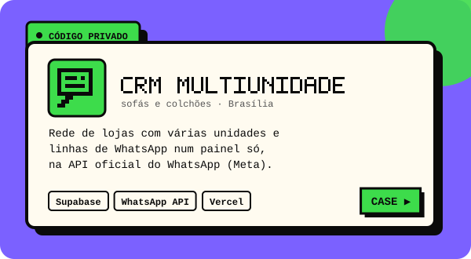
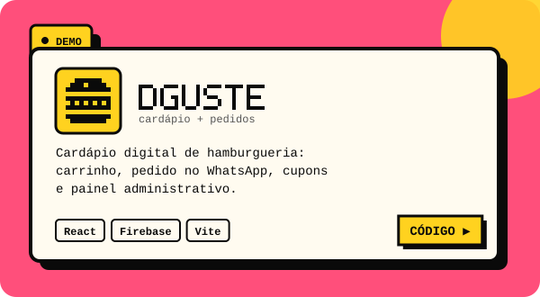

<a href="https://muriloo-ads.github.io"></a>

<p align="center">
  <a href="https://muriloo-ads.github.io"></a>
  <a href="https://ig.me/m/muriloo.ads"></a>
  <a href="https://instagram.com/muriloo.ads"></a>
</p>

```bash
$ whoami
> Murilo Oliveira · dev web + tráfego pago
> Brasília, DF · atendo todo o Brasil

$ echo $MISSAO
> site que vende + anúncio que traz cliente_
```

<a href="https://muriloo-ads.github.io"></a>

## 🕹️ Escolha uma fase

<table>
<tr>
<td width="50%"><a href="https://fvconsultoriaconcursos.com.br"></a></td>
<td width="50%"><a href="https://muriloo-ads.github.io/#projetos"></a></td>
</tr>
<tr>
<td width="50%"><a href="https://github.com/muriloo-ads/dgustesaas"></a></td>
<td width="50%"><a href="https://github.com/muriloo-ads/bytebank-api-design-patterns"></a></td>
</tr>
</table>



<details>
<summary><b>🎁 Abrir baú › serviços</b></summary>
<br>

| power-up | o que você ganha |
|---|---|
| 🌐 **Sites e landing pages** | página rápida, bonita e feita para virar contato |
| 📣 **Tráfego pago (Meta Ads)** | anúncios no Instagram e Facebook levando gente certa até você |
| 🧩 **Sistemas sob medida** | área do aluno, CRM, painéis, login, banco de dados |
| 🎬 **Social media e vídeo** | conteúdo e edição para o seu perfil |

</details>

<details>
<summary><b>🗺️ Ver mapa › como funciona</b></summary>
<br>

```text
[1] conversa no Instagram  ►  entendo seu negócio
[2] proposta               ►  prazo e valor fechados
[3] site no ar             ►  domínio e hospedagem prontos
[4] anúncios (opcional)    ►  clientes chegando
```

</details>

<details>
<summary><b>🛠️ Próximas fases › em construção</b></summary>
<br>

- **Radar de Leads**: encontra no Google Maps negócios sem site, por nicho e cidade, para prospecção.
- **Muriloo Ads · Virtual Office**: escritório virtual em pixel-art onde agentes de IA trabalham como uma equipe.

</details>

<details>
<summary><b>⚙️ Inventário › stack</b></summary>
<br>

          

</details>

<details>
<summary><b>👾 ↑ ↑ ↓ ↓ ← → ← → B A</b></summary>
<br>

```text
MODO DEV ATIVADO ✦ você achou a fase secreta!
manda "ARCADE" no direct pra dizer
que chegou até aqui 👀
```

</details>

<a href="https://ig.me/m/muriloo.ads"></a>
