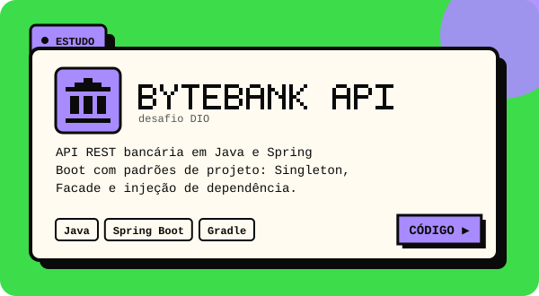

<table>
<tr>
<td width="50%"></td>
<td width="50%"></td>
</tr>
<tr>
<td width="50%"></td>
<td width="50%"></td>
</tr>
</table>

ou no Instagram <a href="https://instagram.com/muriloo.ads">@muriloo.ads</a>

